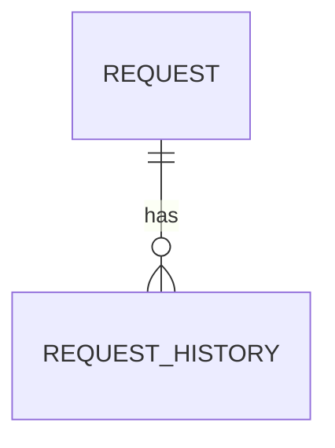

# App Specification — <App name> · v<n>

> Approve at G2 (`MWP-07`). Guide: `references/app-specification.md`. Unknowns are `TBC (Q-xx)`.

## Summary (one page)
- **Purpose**: <problem today> → <outcome and how it is measured>
- **Roles**: <Role A>, <Role B>, System
- **Increments**: 1 <goal> · 2 <goal> · 3 <goal>
- **Entities**: <list>
- **Screens**: <list>
- **Integrations**: <system: operation>
- **Top risks**: <list>
- **Expected manual steps**: create modules, dependencies, translations, environment config, role assignment
- **Open questions**: <count Blocker / Major / Minor>

## 1. Purpose and outcome

## 2. Personas and roles (`MWP-01`)
| Persona | Platform role | Can see | Can do | Must not |
|---|---|---|---|---|

## 3. Logical data model (`MWP-03`)
| Entity | Purpose | Key attributes (name: type, len, mandatory) | Relationships (cardinality, delete rule) | Kind | Audit / soft delete | Volume |
|---|---|---|---|---|---|---|

## 4. Feature map (`MWP-02`)
| Feature | Stories | ACs | Priority | Increment |
|---|---|---|---|---|

## 5. Screens and navigation (`MWP-04`)
| Screen | Purpose | Roles | Entry point | Pattern | Blocks | States |
|---|---|---|---|---|---|---|

## 6. Logic (`MWP-05`)
### Use cases
| Use case | Actor | Rules | Writes | Side effects |
|---|---|---|---|---|
### State machine
| From | To | Action | Actor | Guard | Side effects |
|---|---|---|---|---|---|
### Asynchronous steps
| Step | Trigger | Mechanism | Idempotency key |
|---|---|---|---|

## 7. Integrations (`MWP-06`)
| System | Operation | Direction | Sync/async | Failure behaviour | Test env | Credential owner |
|---|---|---|---|---|---|---|

## 8. Non-functional requirements (`MWP-06`)
| Area | Requirement | Source |
|---|---|---|

## 9. Increments (`MWP-08`)
| # | Usable outcome | Features | Depends on | Risks | MAN steps |
|---|---|---|---|---|---|

## 10. Open questions and assumptions
| ID | Question / assumption | Severity | Recommendation | Status |
|---|---|---|---|---|

## Approval
| Version | Date | Approved by | Scope of approval |
|---|---|---|---|
